# Yuu0413s (ゆう) 👋

## 🧑‍💻 About

人生をより豊かに、楽しくするために色々開発しています

## 🛠 Tech Stack

  <picture>
    <source media="(prefers-color-scheme: dark)" srcset="https://skillicons.dev/icons?i=python%2Ctypescript%2Cjavascript%2Cnodejs%2Cprisma%2Cpostgresql%2Cworkers%2Cnextjs%2Creact%2Cvercel%2Csupabase%2Cgit%2Cgithub%2Cunity%2Clatex&theme=dark" />
    
  </picture>

## 🚀 Highlights

### Hackathon

- 🏆 MUDS 学内ハッカソン 審査員賞 ×2（お財布平和条約 / 先輩後輩マッチング Slack Bot）
- 🤖 Microsoft Agentic Hackathon：業務改善・効率化のための AI エージェントシステムを開発
- 🍚 know-your-meals（MUDS 第3回学内ハッカソン）：美味しかったご飯を写真付きで共有する SNS を開発
- 💪 MyFitCoach（技育CAMP 2025 Vol.8）：目的に合わせたトレーニングメニューを提案するアプリを開発

### Conference

- 🔬 DEIM2026：研究発表「クロノタイプと集中傾向に基づくスケジューリング最適化」

### Experience

- 🖥️ 株式会社マイクロニティ：情報セキュリティ室 AI推進G AIビルダー（エンジニア）
- 💼 株式会社A.I Consulting：バックエンドエンジニアインターン
- 👨‍🏫 株式会社LITALICO ワンダー事業部：プログラミング教室講師

## 📊 Stats

  <picture>
    <source media="(prefers-color-scheme: dark)" srcset="profile/stats-dark.svg" />
    
  </picture>
  <picture>
    <source media="(prefers-color-scheme: dark)" srcset="profile/wakatime-dark.svg" />
    
  </picture>

## 📫 Links

　
