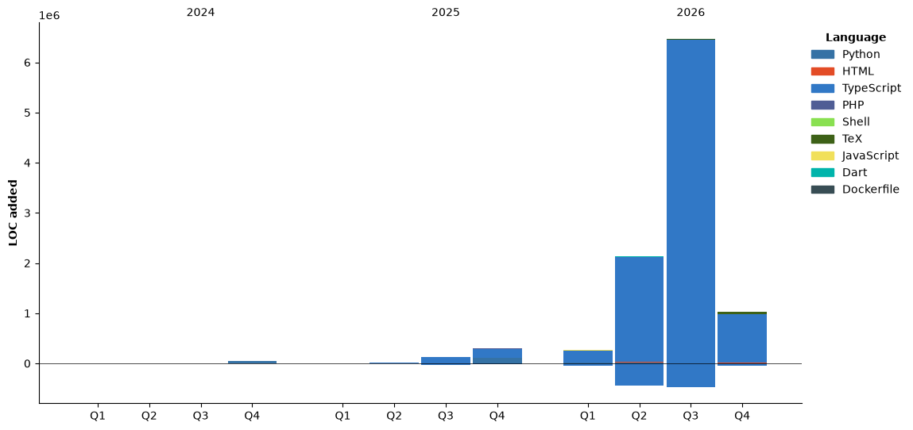

# Yuu0413s (ゆう)

> エンジニア志望 | データサイエンス × より幸せな人生

---

## 🙋 自己紹介

武蔵野大学 データサイエンス学部 3 年生

アニメとゲームと野球と開発が好きなエンジニア志望の学生です。

大学にてデータ分析やエンジニアリングの勉強をしながら、自分や世界の将来について考えています。

ユーザーのQOLを向上させることのできるシステムを開発することが目標です。

- 🎓 **所属**：武蔵野大学 データサイエンス学部（3 年）
- 💼 **志望職種**：エンジニア
- 🔬 **研究テーマ**：クロノタイプと集中傾向に基づくスケジューリング最適化（DEIM2026 発表）
- 📍 **拠点**：東京
- 🎮 **趣味**：プログラミング、ゲーム、野球、推し活

---

## 🛠️ 技術スタック

**言語**


**バックエンド**


**フロントエンド**


**インフラ・ツール**


**その他**


---

## 💼 経験

- **株式会社A.I Consulting**：バックエンドエンジニアインターン（Axis backend プロジェクト）
- **LITALICO Wonder 新宿**：アルバイト（プログラミング・ロボティクス教育）
- **DEIM2026**：研究発表「クロノタイプと集中傾向に基づくスケジューリング最適化」

---

## 🚀 制作物

| # | プロジェクト名 | カテゴリ | 概要 | 技術スタック |
|---|---|---|---|---|
| 1 | know-your-meals（MUDS 第3回学内ハッカソン） | ハッカソン | 友人同士で美味しかったご飯を写真付きで共有できるSNSを制作。要件定義から実装・発表まで完遂。1年前と同じチームメンバーで再挑戦し、自身の成長を測る狙いもあった | React Native, Expo Router, TypeScript, Hono, Drizzle ORM, Neon, Better Auth, Cloudflare R2, Google Maps API, Turborepo, Bun |
| 2 | Microsoft Agentic Hackathon | ハッカソン | Microsoft主催のハッカソン。実務で即使用可能な業務改善・効率化AIエージェントシステムを開発。初めての大型ハッカソンで、新たな知見と就活の幅を広げることを目的に参加 | Azure OpenAI, Azure AI Search, PostgreSQL, React, Next.js |
| 3 | DEIM2026 研究発表 | 研究発表 | 第18回データ工学と情報マネジメントに関するフォーラムにて発表。先行研究の調査から実験設計・論文執筆まで筆頭著者（共著3名）として担当 | Python, pandas, scikit-learn, LaTeX |
| 4 | 技育CAMP ハッカソン Vol.8 | ハッカソン | サポーターズ主催ハッカソン。バックエンド実装担当 | React Native, TypeScript, convex |
| 5 | 小説検索＆推薦システム | 個人開発 | Cloudflare Workers + D1 + Vectorize でバックエンドを構築。Gemini APIで768次元ベクトルを生成しセマンティック検索を実装。5種類の外部APIを統合 | Cloudflare Workers, D1, Vectorize, TypeScript, Gemini API |
| 6 | 先輩後輩マッチングSlack Bot（MUDS 第2回学内ハッカソン） | ハッカソン 🏆 審査員賞 | 先輩後輩マッチングSlack Botを開発・運用。目的・実用性・将来性が評価された | TypeScript, Slack Bolt, Python |
| 7 | お財布平和条約（MUDS 第1回学内ハッカソン） | ハッカソン 🏆 審査員賞 | 精算・割り勘トラブルを解決するWebアプリ。バックエンド・API設計担当。企画・実用性・デプロイまで完遂 | React, TypeScript, Supabase |
| 8 | SMBC Group GREEN×DATA Challenge 2025 | コンペティション | 機械学習を用いた電力価格予測コンペ。特徴量エンジニアリングと複数モデルのアンサンブルで精度向上を図った（933/1071位） | Python, pandas, scikit-learn, LightGBM |


---

## ⏱️ 今週のコーディング統計

<!--START_SECTION:waka-->


**🐱 My GitHub Data** 

> 📦 ? Used in GitHub's Storage 
 > 
> 🏆 1,396 Contributions in the Year 2026
 > 
> 🚫 Not Opted to Hire
 > 
> 📜 22 Public Repositories 
 > 
> 🔑 0 Private Repositories 
 > 
**I'm a Night 🦉** 

```text
🌞 Morning                4416 commits        ████░░░░░░░░░░░░░░░░░░░░░   16.53 % 
🌆 Daytime                8023 commits        ████████░░░░░░░░░░░░░░░░░   30.04 % 
🌃 Evening                6212 commits        ██████░░░░░░░░░░░░░░░░░░░   23.26 % 
🌙 Night                  8057 commits        ████████░░░░░░░░░░░░░░░░░   30.17 % 
```
📅 **I'm Most Productive on Thursday** 

```text
Monday                   2576 commits        ██░░░░░░░░░░░░░░░░░░░░░░░   09.65 % 
Tuesday                  2737 commits        ███░░░░░░░░░░░░░░░░░░░░░░   10.25 % 
Wednesday                5365 commits        █████░░░░░░░░░░░░░░░░░░░░   20.09 % 
Thursday                 8825 commits        ████████░░░░░░░░░░░░░░░░░   33.04 % 
Friday                   4617 commits        ████░░░░░░░░░░░░░░░░░░░░░   17.29 % 
Saturday                 1969 commits        ██░░░░░░░░░░░░░░░░░░░░░░░   07.37 % 
Sunday                   619 commits         █░░░░░░░░░░░░░░░░░░░░░░░░   02.32 % 
```


📊 **This Week I Spent My Time On** 

```text
🕑︎ Time Zone: Asia/Tokyo

💬 Programming Languages: 
TypeScript               5 hrs 2 mins        ███████████░░░░░░░░░░░░░░   43.18 % 
Markdown                 2 hrs 50 mins       ██████░░░░░░░░░░░░░░░░░░░   24.34 % 
CSV                      59 mins             ██░░░░░░░░░░░░░░░░░░░░░░░   08.48 % 
Other                    58 mins             ██░░░░░░░░░░░░░░░░░░░░░░░   08.38 % 
HTML                     32 mins             █░░░░░░░░░░░░░░░░░░░░░░░░   04.61 % 

🔥 Editors: 
Claude Code              9 hrs 19 mins       ████████████████████░░░░░   79.74 % 
VS Code                  1 hr 20 mins        ███░░░░░░░░░░░░░░░░░░░░░░   11.50 % 
Codex Vscode             1 hr 1 min          ██░░░░░░░░░░░░░░░░░░░░░░░   08.76 % 

🐱‍💻 Projects: 
aix-hub                  8 hrs 4 mins        █████████████████░░░░░░░░   69.08 % 
yuu0413                  1 hr 13 mins        ███░░░░░░░░░░░░░░░░░░░░░░   10.43 % 
2622063-Scraping-task    1 hr 2 mins         ██░░░░░░░░░░░░░░░░░░░░░░░   08.97 % 
paper                    19 mins             █░░░░░░░░░░░░░░░░░░░░░░░░   02.81 % 
専門デプロイメントⅢ               16 mins             █░░░░░░░░░░░░░░░░░░░░░░░░   02.34 % 

💻 Operating System: 
Mac                      11 hrs 41 mins      █████████████████████████   100.00 % 
```

🤖 **AI Coding This Week** 

```text
⏱ AI Coding Time: 10 hrs 40 mins (91.34%)

✍️ 7,307 lines written by AI, 3,641 lines written by hand (66.74% AI-written)

🔤 5,765,475 Input Tokens, 876,357 Output Tokens

💵 $74.05 Estimated AI Cost This Week

🧠 67 AI Sessions, 273 AI Prompts

Opus                     7,420 lines         █████████████████████████   100.00 % 
GPT                      0 lines             ░░░░░░░░░░░░░░░░░░░░░░░░░   00.00 % 

🔎 AI Coding Insights:
🤖 AI-Driven — 66.74% of written lines came from AI
📚 Verbose Prompter — average 1,863 characters per prompt
🔁 Iterative Prompter — average 4 prompts per session
🚀 High AI Trust — 32.94% of changed lines were hand-edited
```

**I Mostly Code in TypeScript** 

```text
TypeScript               17 repos            ██████████░░░░░░░░░░░░░░░   41.46 % 
TeX                      7 repos             ████░░░░░░░░░░░░░░░░░░░░░   17.07 % 
Python                   6 repos             ████░░░░░░░░░░░░░░░░░░░░░   14.63 % 
HTML                     4 repos             ██░░░░░░░░░░░░░░░░░░░░░░░   09.76 % 
JavaScript               3 repos             ██░░░░░░░░░░░░░░░░░░░░░░░   07.32 % 
```


**Timeline**




 Last Updated on 13/11/2026 21:28:53 UTC
<!--END_SECTION:waka-->

---

## 🔗 リンク

- 🌐 **ポートフォリオ**：[yuu0413.com](https://yuu0413.com)
- 🐦 **Twitter/X**：[@Yuu0413_s](https://twitter.com/Yuu0413_s)
